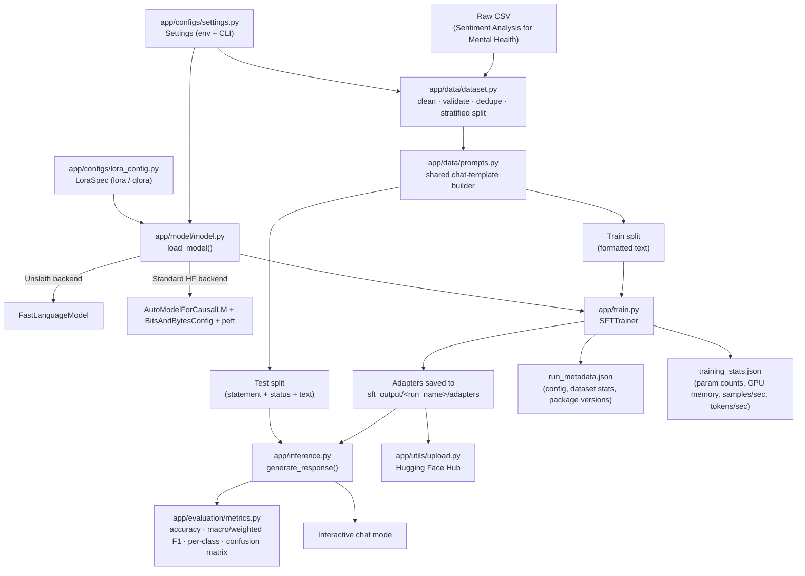

<div align="center">
  
</div>

<div align="center">
  <a href="https://www.python.org/downloads/release/python-3110/" target="_blank">
  </a>
  <a href="https://pytorch.org/get-started/locally/" target="_blank">
    </a>
  <a href="https://developer.nvidia.com/cuda-12-4-0-download-archive" target="_blank">
  </a>
  <a href="https://github.com/Dalageo/fine-tuning-llms/blob/dev/LICENSE" target="_blank">
    </a>
  
</div>

# Fine-Tuning Large Language Models 🧠

This project implements a resource-efficient method for fine-tuning Large Language Models (LLMs) on consumer-grade hardware. It focuses on the technical implementation of **Parameter-Efficient Fine-Tuning (PEFT)**, offering a modular codebase that supports two distinct training pathways: the standard [**Hugging Face**](https://huggingface.co/) library and the optimized [**Unsloth**](https://unsloth.ai/) framework.

The key to achieving this resource-efficient method lies in the use of [**Low-Rank Adaptation (LoRA)**](https://arxiv.org/pdf/2106.09685). Instead of retraining the full model parameters, a process that requires massive computational resources, LoRA freezes the pre-trained model and injects trainable rank-decomposition matrices into the transformer layers. For memory optimization, the project also supports [**QLoRA (Quantized LoRA)**](https://arxiv.org/pdf/2305.14314). This technique quantizes the frozen base model to **4-bit precision** to significantly reduce memory usage (VRAM) while maintaining model performance. Apart from standard **LoRA** and **QLoRA**, the project also offers an **Unsloth** mode, which uses optimized low-level GPU kernels to execute training with lower VRAM usage. [Unsloth's own published benchmarks](https://unsloth.ai/) report substantial speedups over standard implementations; this repository does not independently benchmark that claim (see [Limitations](#-project-limitations)), so treat it as Unsloth's claim, not this repo's measured result.

The entire implementation is demonstrated using [**Google's Gemma-3-1B-IT**](https://huggingface.co/google/gemma-3-1b-it) as the base model and serves as a practical reference for developers looking to adapt similar architectures to downstream tasks.

<br>

## 🏗️ Architecture



Both backends (Unsloth / standard HF) read the **same** LoRA hyperparameters from `app/configs/lora_config.py`, and both training and inference build prompts through the **same** `app/data/prompts.py` function — this is a deliberate design choice, not an accident: it's what keeps "LoRA vs QLoRA vs Unsloth" comparisons meaningful and keeps what the model was fine-tuned on identical to what it sees at inference time.

<br>

## 📜 Dataset Description

The project uses the [**Sentiment Analysis for Mental Health**](https://www.kaggle.com/datasets/suchintikasarkar/sentiment-analysis-for-mental-health) dataset for experimentation, which contains user statements labeled with mental health conditions. This dataset is structured in a simple CSV format containing approximately 53,000 rows. Each entry consists of a unique identifier, the raw text statement, and the corresponding ground-truth label, classified into seven distinct categories. It is important to note that the classes are imbalanced, with conditions like "Normal" and "Depression" being significantly more represented than "Personality Disorder" or "Bi-Polar." This imbalance is the reason evaluation in this project never relies on accuracy alone (see [Evaluation](#-evaluation)). The specific labels used in this project are detailed below:

| Label | Description |
| :--- | :--- |
| **Normal** | General conversation, neutral observations, or positive sentiment without distress. |
| **Depression** | Statements reflecting persistent sadness, hopelessness, lethargy, or loss of interest. |
| **Suicidal** | High-risk content indicating self-harm ideation or intent. |
| **Anxiety** | Expressions of excessive worry, nervousness, panic, or unease. |
| **Stress** | Reactions to external pressure, tension, burnout, or inability to cope. |
| **Bi-Polar** | Text exhibiting rapid mood cycling, manic energy, or depressive lows. |
| **Personality Disorder** | Patterns of behavior or inner experience that deviate markedly from expectations. |

`app/data/dataset.py` reports the exact class distribution and how many rows were dropped (missing values, duplicates, invalid labels) every time the dataset is loaded — see `DatasetStats.summary()`.

<br>

## ⚠️ Safety Considerations

**This is an experimental research text-classification model, not a clinical or diagnostic tool.** It classifies short text statements against seven labels from a public research dataset; it was not designed, validated, or approved for making decisions about a real person's mental health. The inference system's system prompt explicitly instructs the model not to provide medical advice, diagnosis, or empathetic commentary, precisely to keep its role scoped to research classification rather than clinical interaction. Do not use this project's output to diagnose, triage, or make decisions about yourself or anyone else. If you or someone you know is struggling, please contact a mental health professional or a crisis line in your country.

<br>

## 🛠️ Development Workflow

This project follows a three-tier branching strategy with automated deployments:

### Branch Structure

- **`dev`** - Development branch for active feature work
- **`tst`** - Testing/staging environment for validation
- **`prd`** - Production-ready stable releases

### CI/CD Pipeline

**Continuous Integration** (`.github/workflows/ci.yml`):
- Runs on every push/PR to `dev`, `tst`, or `prd`
- Lints (`ruff`) and runs the CPU-only unit test suite (`pytest`)
- Deliberately does **not** run GPU training — see [Testing](#-testing)

**Automatic Deployment (dev → tst)**:
- A push to `dev` first runs the CI checks above as a gate, then, if they pass, merges `dev` into `tst`
- Workflow: `.github/workflows/deploy_tst.yml`

**Manual Deployment (tst → prd)**:
- Deployment to `prd` requires manual approval via GitHub Actions
- Only executable from the `tst` branch
- Workflow: `.github/workflows/deploy_prd.yml`

*Although this is a personal project, the CI/CD pipeline adheres to professional standards for maintaining a stable codebase and facilitating effective collaboration.*

<br>

## ⚙️ Setup Instructions

### Prerequisites

- **Operating System:** A **Linux environment (Ubuntu, Debian, etc.) or Windows Subsystem for Linux (WSL 2)**.
- **NVIDIA GPU** with CUDA 12.4 support (RTX 30/40 series recommended)
- **Python 3.11**
- [**Poetry**](https://github.com/python-poetry/poetry) for dependency management
- **HuggingFace Account** with a valid [User Access Token](https://huggingface.co/settings/tokens)

> **No NVIDIA GPU on your machine?** This project cannot run training/inference on
> CPU or on integrated graphics (Intel Iris Xe, AMD integrated GPUs, Apple Silicon)
> — `bitsandbytes` 4-bit quantization and Unsloth are CUDA-only. Skip straight to
> **[docs/COLAB.md](docs/COLAB.md)** for a copy-paste Google Colab / Kaggle
> Notebooks setup (both offer a free NVIDIA T4 GPU) instead of the Poetry
> instructions below. Every entrypoint (`app/train.py`, `app/inference.py`) calls
> `app.utils.environment.require_cuda()` first and will tell you immediately, with
> an actionable message, if no CUDA GPU is available — rather than failing deep
> inside a library with a cryptic error.

### Installation

1. **Clone the repository**:
   ```bash
   git clone https://github.com/Dalageo/fine-tuning-llms.git
   cd fine-tuning-llms
   ```

2. **Install Poetry** (if not already installed):
   ```bash
   curl -sSL https://install.python-poetry.org | python3 -
   ```

3. **Install dependencies**:
   ```bash
   poetry install
   ```
   This installs PyTorch 2.6.0 with CUDA 12.4, Unsloth, Transformers, PEFT, TRL, and all required packages. `unsloth`/`unsloth-zoo` are pinned to a specific commit (not a floating branch) for reproducibility — see the comment above them in `pyproject.toml` if you need to bump them.

4. **Configure your environment**:
   ```bash
   cp .env.example .env
   ```
   Then edit `.env` — at minimum set `HF_TOKEN` and `DATASET_PATH`. See `.env.example` for every available setting (LoRA mode, Unsloth on/off, sequence length, seed, etc.) and `app/configs/settings.py` for validation rules and defaults. Every setting can also be overridden per-run via CLI flags (see below) without editing `.env`.

### Configuration

All configuration lives in `app/configs/settings.py` (a validated `Settings` dataclass), resolved from environment variables with CLI overrides taking priority. Nothing is hardcoded in source beyond sensible defaults, and secrets (`HF_TOKEN`) are never given a default value. Key settings:

| Setting | Env var | Default | Notes |
| :--- | :--- | :--- | :--- |
| Backend | `USE_UNSLOTH` | `true` | Unsloth vs standard HF |
| LoRA mode | `LORA_MODE` | `qlora` | `lora` or `qlora` |
| Dataset path | `DATASET_PATH` | *(required)* | Fails with a clear error if unset/missing |
| Sequence length | `MAX_SEQ_LENGTH` | `1024` | Single value used by both model loading and `SFTConfig` |
| Seed | `SEED` | `42` | Used for the dataset split and all RNGs |
| Test split size | `TEST_SIZE` | `0.2` | |
| Upload target | `HF_USERNAME` / `HF_PERSONAL_REPO_ID` | *(required for upload)* | |

### Training

```bash
poetry run python -m app.train
poetry run python -m app.train --lora-mode lora --no-unsloth   # compare configurations
poetry run python -m app.train --dataset-path /path/to/data.csv --max-steps 500 --seed 7
poetry run python -m app.train --resume                        # resume from the latest local checkpoint
poetry run python -m app.train --resume sft_output/.../checkpoint-600  # resume from an explicit checkpoint
```

Each run writes to its own directory, `sft_output/<run_name>/`, where `run_name` encodes the model, LoRA mode, and backend (so switching modes never overwrites a previous run). It contains:
- Adapter weights (`adapters/adapter_model.safetensors`)
- Tokenizer files (`adapters/`)
- Checkpoints (per `save_steps`)
- `run_metadata.json` — the effective settings, dataset class-distribution stats, and installed package versions for that run (see [Reproducibility](#-reproducibility))
- `training_stats.json` — trainable/total parameter counts and percentage, peak GPU memory allocated/reserved, and the trainer's own runtime/throughput metrics (`train_runtime`, `train_samples_per_second`, `train_tokens_per_second`) — the actual measured numbers behind any efficiency claim, captured via PyTorch's CUDA memory API and `transformers.Trainer`'s built-in instrumentation rather than hand-estimated

`--resume` only helps when the local checkpoint directory still exists (e.g. a training script that crashed for a non-environment reason, or a deliberate multi-session run on a persistent machine). It does **not** help after an ephemeral environment (Colab, Kaggle) wipes its filesystem — for that, see `AUTO_UPLOAD_TO_HUB` below, which protects against exactly that case by pushing checkpoints off-machine as training runs.

### Evaluation

```bash
poetry run python -m app.inference --mode eval --num-samples 50
poetry run python -m app.inference --mode eval   # full test split
```

This runs generation over the (stratified) held-out test split and reports **accuracy, macro precision/recall/F1, weighted F1, per-class precision/recall/F1/support, and a confusion matrix** — not accuracy alone, since the dataset is imbalanced. Model output is normalized against the seven known labels (`app/data/prompts.normalize_label`) before scoring, so cosmetic differences (casing, punctuation, "Bipolar" vs "Bi-Polar") don't get counted as wrong; anything that still doesn't match a known label is counted separately as `unparseable_predictions` rather than silently miscounted. Results are printed as a human-readable summary and saved as machine-readable JSON to `sft_output/<run_name>/eval_metrics.json`.

### Interactive Inference

```bash
poetry run python -m app.inference --mode chat
```

### Upload to Hugging Face Hub

```bash
poetry run python -m app.utils.upload
```

Uploads `settings.adapter_dir` to `settings.hf_personal_repo_id` (derived from `HF_USERNAME`, or set `HF_PERSONAL_REPO_ID` explicitly). There is no hardcoded default namespace — the command fails with an actionable error if neither is set, rather than silently uploading to someone else's account.

**Automatic upload during training** (`AUTO_UPLOAD_TO_HUB=true`): in an ephemeral environment like Colab or Kaggle, the local filesystem can be wiped by a disconnect with no warning, losing any unsaved training progress. Setting this env var (alongside `HF_TOKEN` + `HF_USERNAME`/`HF_PERSONAL_REPO_ID`) pushes adapters to Hub automatically at every checkpoint (`save_steps`) during training, not just once at the end — so a disconnect only costs progress since the last checkpoint, not the whole run. Off by default since it's a real side effect on your Hub account; upload failures are logged but never crash an otherwise-successful training run.

<br>

## 📁 Project Structure

```
fine-tuning-llms/
├── app/
│   ├── configs/
│   │   ├── settings.py         # Validated Settings (env + CLI), single source of truth
│   │   └── lora_config.py      # LoRA/QLoRA hyperparameters (LoraSpec), shared by both backends
│   ├── data/
│   │   ├── dataset.py          # Load, clean, validate, stratified split, format
│   │   └── prompts.py          # Shared chat-template builder (train == inference format)
│   ├── evaluation/
│   │   └── metrics.py          # Accuracy, macro/weighted F1, per-class, confusion matrix
│   ├── model/
│   │   ├── model.py            # Model loading logic (Unsloth/Standard)
│   │   └── tokenizer.py        # Tokenizer initialization
│   ├── utils/
│   │   ├── download.py         # Download the base model from HF Hub
│   │   ├── upload.py           # Upload trained adapters to HF Hub
│   │   ├── logging_utils.py    # Structured logging setup
│   │   ├── seeding.py          # Reproducibility seeding (python/numpy/torch)
│   │   └── environment.py      # GPU detection with actionable errors (require_cuda)
│   ├── train.py                # Training pipeline (CLI)
│   └── inference.py            # Inference/evaluation pipeline (CLI)
├── tests/
│   ├── conftest.py             # Shared fixtures (fake tokenizer, synthetic CSV)
│   └── unit/                   # CPU-only tests: settings, dataset, prompts, metrics
├── docs/
│   └── COLAB.md                # Run on Google Colab / Kaggle (no local GPU needed)
├── .env.example                # Template for required environment variables
├── requirements-colab.txt      # pip-installable deps for notebook environments
├── pyproject.toml              # Poetry dependencies
```

<br>

## 🧪 Testing

```bash
poetry install --with dev
poetry run pytest tests/ -v
poetry run ruff check app/ tests/
```

The unit test suite (52 tests) covers configuration validation, dataset cleaning/validation/stratified-splitting, the shared prompt-formatting logic, and the evaluation metrics — all on CPU, with no GPU, model weights, or the real dataset required (a synthetic CSV fixture is used instead). It runs in CI (`.github/workflows/ci.yml`) on every push/PR.

**What is not covered by automated tests**, and why: model loading, training, and generation require a CUDA GPU, real model weights, and (for training) the actual dataset — none of which are available in a standard CI runner. These code paths (`app/model/model.py`, the training loop in `app/train.py`, generation in `app/inference.py`) were validated by manual inspection and by running the pipeline end-to-end on real GPU hardware; they are not exercised by an automated GPU CI job in this repository. If you have GPU CI available, a reasonable next step is a self-hosted runner workflow that trains for a handful of steps as a smoke test.

<br>

## ♻️ Reproducibility

- A single `SEED` controls Python, NumPy, PyTorch, and dataset-split RNGs (`app/utils/seeding.py`).
- The train/test split is stratified by label and deterministic given the seed (see `tests/unit/test_dataset.py::test_prepare_dataset_is_deterministic_given_seed`).
- Every training run saves `run_metadata.json` alongside its adapters: the effective `Settings`, the dataset's class-distribution stats (rows kept/dropped and why), and installed package versions — so a run can be understood later without guessing what configuration produced it.
- The `unsloth`/`unsloth-zoo` git dependencies are pinned to specific commits, not a floating branch, so `poetry install` resolves the same code every time until you deliberately bump them.

<br>

## ❓ Troubleshooting

### CUDA Out of Memory
- Reduce `per_device_train_batch_size` in `app/train.py`
- Increase `gradient_accumulation_steps`
- Lower `MAX_SEQ_LENGTH` (e.g., from 1024 to 512)
- Use QLoRA instead of LoRA (`LORA_MODE=qlora`)

### "Your setup doesn't support bf16/gpu. You need Ampere+ GPU"
- This means your GPU is older than Ampere (e.g. a Tesla T4, as Colab's free
  tier provides — Turing architecture, compute capability 7.5) and doesn't
  support bfloat16 in hardware. `app/train.py` detects this automatically via
  `app.utils.environment.supports_bf16()` and switches to fp16 — if you're
  seeing this error, you're running against an older, un-patched version of
  the code; update to the latest.

### Training hangs at "wandb: Enter your choice:"
- `SFTConfig` defaults to `report_to="none"` — training never prompts for an
  experiment tracker. If you still see this prompt, you're on an outdated
  copy of the code; update to the latest. To opt into Weights & Biases
  deliberately, set `REPORT_TO=wandb` before running `app.train`.

### Slow Training
- Enable `USE_UNSLOTH=true`
- Verify CUDA is being used: `torch.cuda.is_available()`
- Check GPU utilization: `nvidia-smi`

### Dependency Conflicts
- Use Poetry's lock file: `poetry install --sync`
- Ensure PyTorch is from the CUDA 12.4 source: check `pyproject.toml`
- If `unsloth`/`unsloth-zoo` fail to resolve, confirm the pinned commit hashes in `pyproject.toml` still exist upstream

### "Dataset not found" / "Missing HF_TOKEN"
- These are now explicit, actionable errors raised by `Settings.require_dataset_path()` / `Settings.require_hf_token()` rather than a generic crash — the message tells you exactly which `.env` variable to set.

<br>

## 🚧 Project Limitations

- **Small base model.** Gemma-3-1B-IT is chosen for accessibility on consumer GPUs, not for state-of-the-art classification accuracy.
- **No independent Unsloth speed/VRAM benchmark in this repo.** Unsloth's own published numbers are not re-verified here (see Architecture section); if you need a documented comparison, run both backends under the same `Settings` and record the numbers `app/train.py` already logs (trainable parameter count, training time).
- **Generative classification, not a dedicated classifier head.** The model generates label text rather than using a softmax classification head, which is simpler to fine-tune with SFT but means malformed generations are possible (tracked as `unparseable_predictions` in evaluation output).
- **English-only evaluation.** The dataset and prompt instructions are English; behavior on other languages is untested.
- **No automated GPU CI.** See [Testing](#-testing).

## 🔭 Next Steps

- A self-hosted-runner GPU workflow that trains a few steps as an end-to-end smoke test in CI.
- An actual benchmark run (LoRA vs QLoRA vs Unsloth+QLoRA) using the `training_stats.json` each run already produces (VRAM, samples/sec, tokens/sec), to replace "Unsloth reports..." with this repo's own measured numbers — the capture mechanism exists, only the actual multi-run comparison is still outstanding.
- Extending `app/data/dataset.py` to accept a small config describing which CSV columns to use, so another classification dataset can be plugged in without code changes.

<br>

## ✨ Acknowledgments

Special thanks to [Google](https://deepmind.google/models/gemma/) for developing and releasing open-source models, to the [Hugging Face](https://huggingface.co/) community for hosting the models and providing the Transformers, PEFT, and TRL libraries, and to [Unsloth AI](https://github.com/unslothai/unsloth) for their optimized training framework that makes it easier for individuals to experiment with LLMs using their own GPUs. Their contributions were essential to this project.

<div align="center">
  <br>
  <a href="https://huggingface.co/">
    </a>
  &nbsp;&nbsp;&nbsp;&nbsp;
  <a href="https://huggingface.co/">
    </a>
  &nbsp;&nbsp;&nbsp;&nbsp;
  <a href="https://unsloth.ai/">
    </a>
</div>

<br>

## ⚖️ License

This repository utilizes components with different licenses:

* **The Code & Documentation:** Licensed under the **[AGPL-3.0 license](https://www.gnu.org/licenses/agpl-3.0.en.html)**.
    > The AGPL-3.0 license was chosen to promote open collaboration, ensure transparency, and require that any modifications or improvements must also be shared under the same license, with appropriate acknowledgment.

* **The Base LLM Weights:** Gemma weights used for fine-tuning are subject to their respective Google's terms **[Gemma Terms of Use](https://ai.google.dev/gemma/terms)**.

* **The Unsloth Framework:** Unsloth AI is an open-source tool licensed under the **[Apache License 2.0](https://github.com/unslothai/unsloth/blob/main/LICENSE)**.

* **Dataset**: The [Sentiment Analysis for Mental Health](https://www.kaggle.com/datasets/suchintikasarkar/sentiment-analysis-for-mental-health) dataset may have its own license terms on Kaggle.

<div align="center">
  <br>
  <a href="https://www.gnu.org/licenses/agpl-3.0.en.html">
    </a>
    &nbsp;&nbsp;&nbsp;&nbsp;
  <a href="https://www.apache.org/licenses/LICENSE-2.0">
    </a>
    &nbsp;&nbsp;&nbsp;&nbsp;
  <a href="https://ai.google.dev/gemma/terms">
    </a>
</div>
